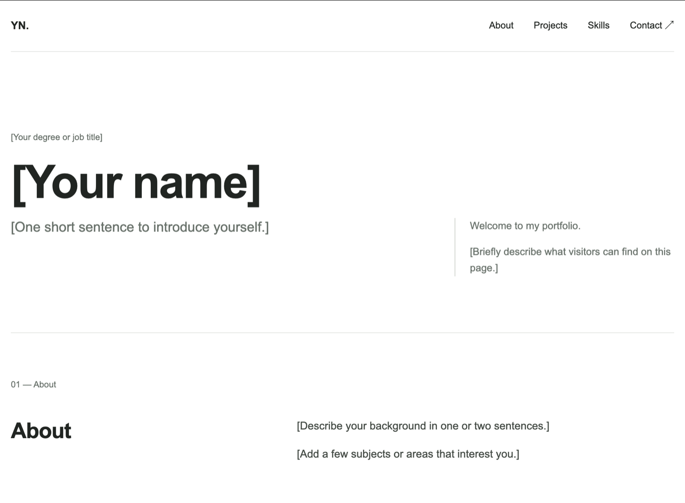
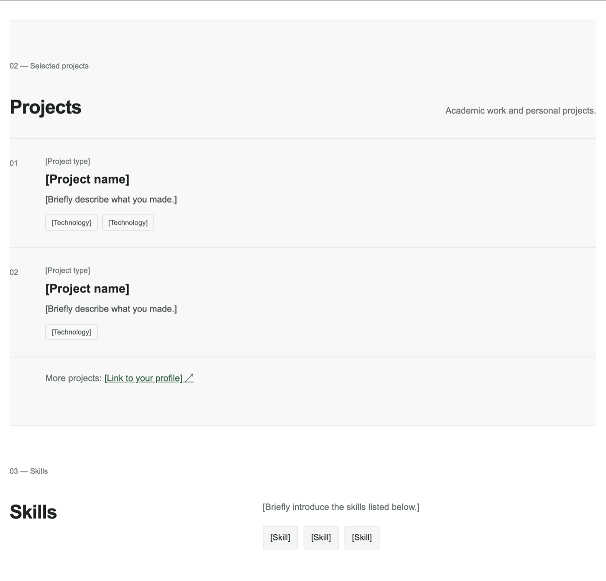
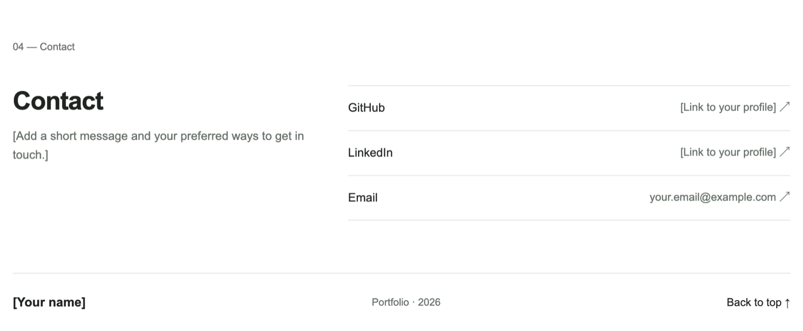

# Simple portfolio template

A one-page portfolio template made with HTML, CSS and a small amount of JavaScript. Personal details are kept in one file, `portfolio.json`, so you can update the site without editing the page layout.

## Preview

### Home and about section



### Projects and skills



### Contact section



## Personalise the portfolio

Open `portfolio.json` in a text editor. You can use VS Code, Notepad, or TextEdit in plain-text mode. Change the values inside the quotation marks and save the file. The page reads this file and displays the updated information.

The file is split into sections:

- `description`, `name`, `initials`, `role`, `intro` and `welcome` control the browser tab and the top section of the page.
- `about` contains the two short paragraphs in the About section.
- `projects` contains the project cards. Each project has a type, name, description and list of technologies.
- `otherProjects` contains the label and link shown below the project cards.
- `skillsIntro` and `skills` control the Skills section.
- `contactIntro` and `contact` control the contact message and links. Leave a contact value as an empty string (`""`) to hide that link.

### Change the number of projects or skills

Project cards and skills are lists between square brackets. To add a project, copy one project entry, paste it after the last one, and change its text. Put a comma between entries, but not after the last entry. For example:

```json
"projects": [
  {
    "type": "Personal project",
    "name": "My project",
    "description": "A short description of what I made.",
    "technologies": ["HTML", "CSS"]
  },
  {
    "type": "Course project",
    "name": "Another project",
    "description": "Another short description.",
    "technologies": ["Python"]
  }
]
```

Add or remove skills by editing the values in the `skills` list in the same way. Keep the quotation marks, commas and square brackets in place. If the page stops updating, check that every opening `{` or `[` has a matching closing character and that there is a comma between values.

### Change the browser tab icon or colours

These are optional changes outside `portfolio.json`:

- To change the icon, open `favicon.svg` in a text editor and replace the letter `P` with your initial.
- To change colours, open `css/styles.css` and edit the colour values near the top: `--background`, `--text`, `--muted`, `--line` and `--accent`.

## Run the site

Because the page loads `portfolio.json`, do not open `index.html` directly as a file. Start a small local web server from this folder:

```bash
python3 -m http.server 8000
```

Then visit <http://localhost:8000>. The page will reload with your saved changes when you refresh the browser.

## How the code works

- `portfolio.json` is the only file most people need to edit.
- `index.html` contains the page structure and section names.
- `css/styles.css` controls the layout and appearance. It uses basic CSS Grid and Flexbox. The `@media (max-width: 640px)` part adjusts the layout for phone screens.
- `js/main.js` reads `portfolio.json`, puts its text and links into the page, and displays the current year in the footer.
- `photos/` contains the example screenshots shown above. `.gitignore` ignores other files added to this folder while keeping these three preview images in the repository.

## Publish on Infomaniak

This is a static website, so there is no build step. Upload `index.html`, `portfolio.json`, `favicon.svg`, and the `css` and `js` folders to your website's web root using Infomaniak Web FTP. Keep the folder structure unchanged. After changing `portfolio.json`, upload the updated file as well.
